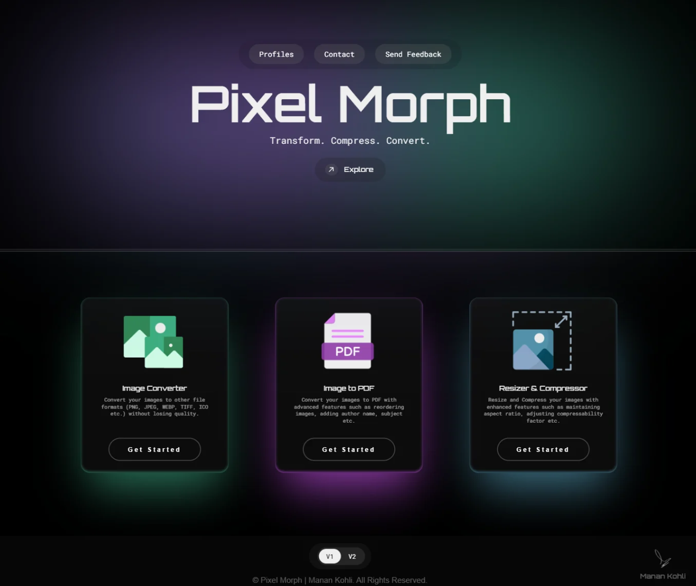
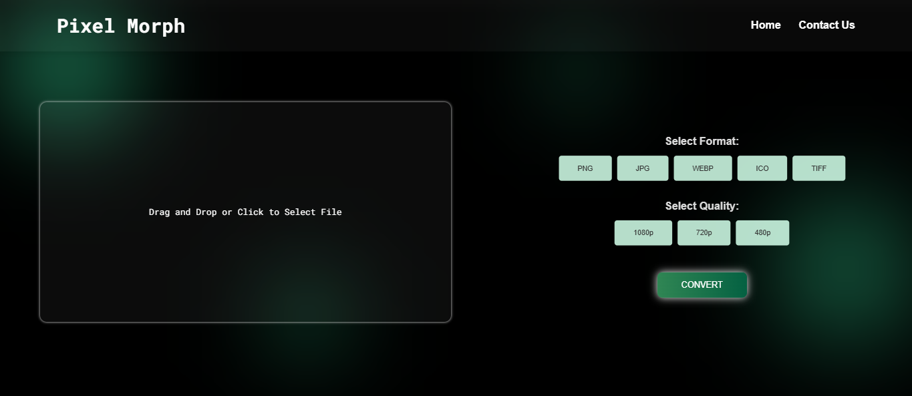
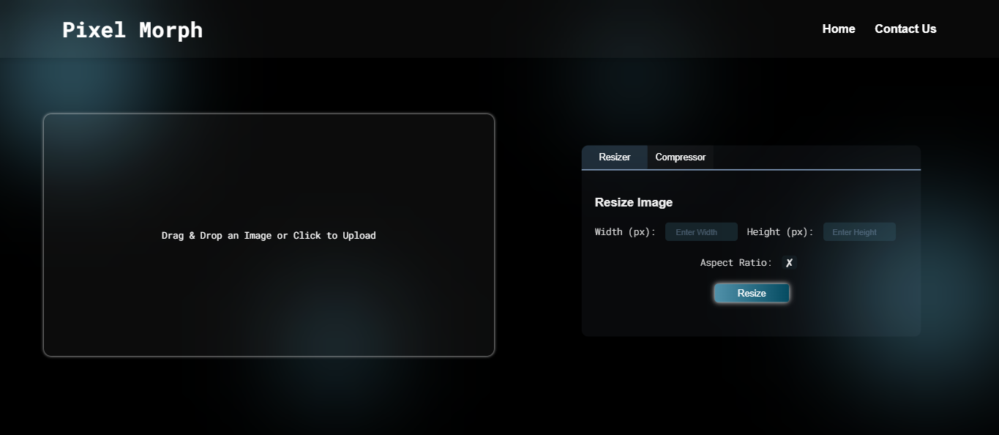
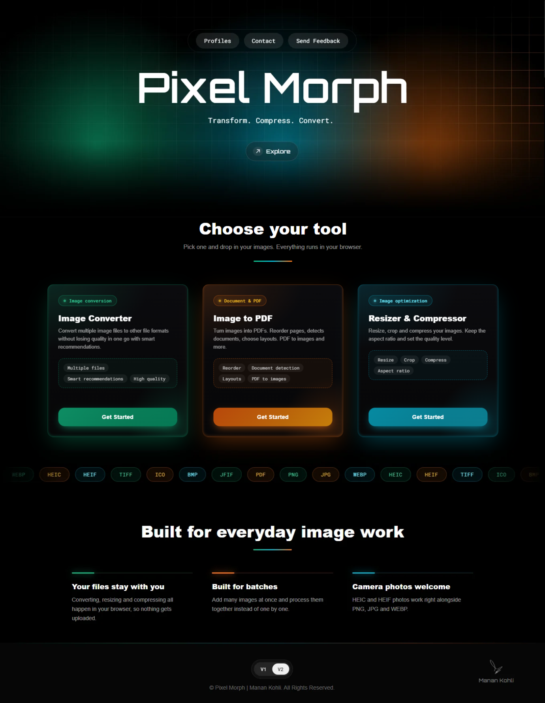

# 🖼️ PixelMorph

### One Platform. Multiple Possibilities. Better Image Processing.

PixelMorph is a web-based image processing toolkit designed to make everyday image operations simple, accessible, and efficient. From converting image formats to resizing, compressing, and creating PDFs, PixelMorph brings essential image utilities together in one place.

The project has evolved through two versions, each introducing improvements in design, functionality, and user experience.

**Explore the original experience or try the latest redesigned version!**

🌐 **Live Website:** [PixelMorph](https://manankohli2310.github.io/PixelMorph/)

---

# 📌 Table of Contents

- [Project Overview](#-project-overview)
- [Version 1.0 – The Original Experience](#-version-10--the-original-experience)
  - [Overview](#v1-overview)
  - [Interface Preview](#v1-interface-preview)
  - [Available Tools](#v1-available-tools)
- [Version 2.0 – The Next Evolution](#-version-20--the-next-evolution)
  - [Overview](#v2-overview)
  - [Interface Preview](#v2-interface-preview)
  - [Available Tools](#v2-available-tools)
- [V1 vs V2 – What's Changed?](#-v1-vs-v2--whats-changed)
- [Technology Stack](#-technology-stack)
- [Project Structure](#-project-structure)
- [Getting Started](#-getting-started)
- [Future Improvements](#-future-improvements)
- [Contributing](#-contributing)

---

# 🚀 Project Overview

PixelMorph started with a simple idea: making common image processing tasks easier without requiring complicated software or installations.

Over time, the project evolved into a more comprehensive platform, introducing a redesigned interface, improved navigation, additional functionality, and a better overall user experience.

PixelMorph currently offers two versions:

| Version | Description | Status |
|---|---|---|
| V1.0 | Original PixelMorph experience | Classic |
| V2.0 | Redesigned PixelMorph with enhanced functionality | Latest |

Both versions remain accessible, allowing users and developers to explore the project's evolution.

---

# 🟦 Version 1.0 – The Original Experience

### V1.0 — The Beginning of PixelMorph

**V1** is the original version of PixelMorph, developed with a focus on simplicity and essential image processing functionality.

It provides a straightforward interface where users can perform common image operations without unnecessary complexity.

**🌐 Live Website:** [Open PixelMorph V1](https://manankohli2310.github.io/PixelMorph/v1.html)

## 📸 Interface Preview

*The original PixelMorph interface.*

## 🛠️ Available Tools

### 1. Image Converter

Convert images between supported formats, including PNG, JPG, and ICO.

### 2. Image to PDF Converter

Convert images into PDF documents for easier sharing and documentation.

### 3. Image Resizer & Compressor

Reduce image file sizes to make them easier to store, share, and upload.

---

# 🟪 Version 2.0 – The Next Evolution

### V2.0 — A Redesigned and Enhanced Experience

**V2 is the latest evolution of PixelMorph**, featuring a completely refreshed visual experience, a modern interface, improved navigation, and expanded image processing capabilities.

The redesign focuses on making the platform more intuitive, visually appealing, responsive, and convenient to use.

While retaining the core idea of the original version, V2 takes PixelMorph further with an improved layout, modern styling, and additional functionality.

✨ Latest Version · Recommended Experience

**🌐 Live Website:** [Open PixelMorph V2](https://manankohli2310.github.io/PixelMorph/)

## 📸 Interface Preview

*The redesigned PixelMorph V2 interface.*

## ✨ What's New in V2?

- Completely redesigned user interface.
- Modern visual theme and improved styling.
- Enhanced navigation and layout.
- Expanded image processing functionality.
- Improved responsiveness across screen sizes.
- Better user experience and accessibility.
- More organized presentation of tools and features.

## 🛠️ Available Tools

### 1. Image Format Converter

Convert images between supported formats with an improved interface and streamlined workflow.

### 2. Image Resizer

Resize images with a more refined interface and convenient controls.

### 3. Image Compressor

Compress images to reduce their file size while maintaining the desired output quality.

### 4. Image to PDF Converter

Transform images into PDF documents through an improved conversion experience.

### 5. Additional Tools

V2 introduces additional functionality beyond the original set of tools.

<!-- Add individual tool headings, descriptions and screenshots here as the V2 feature list is finalized. -->

---

# ⚡ V1 vs V2 – What's Changed?

PixelMorph V2 is not just a visual update; it represents an improvement in the overall platform experience.

| Aspect | V1 – Original | V2 – Latest |
|---|---|---|
| Interface | Classic | Modern |
| Theme | Original design | Redesigned theme |
| Layout | Basic layout | Improved layout |
| Navigation | Simple | Enhanced |
| User Experience | Essential | Refined |
| Features | Core tools | Expanded toolkit |
| Responsiveness | Original implementation | Improved |
| Overall Experience | Lightweight and simple | More comprehensive |

### The Evolution

**V1:** Built around simplicity and essential image processing.

**V2:** Built around improved functionality, modern design, and a more complete user experience.

---

# 💻 Technology Stack

PixelMorph is developed using web technologies:

| Technology | Purpose |
|---|---|
| HTML5 | Website structure |
| CSS3 | Styling and layouts |
| JavaScript | Functionality and image processing |
| Git & GitHub | Version control and project hosting |
| GitHub Pages | Website deployment |

---

# 🤝 Contributing

Contributions, suggestions, and feedback are welcome!

If you find a bug or have an idea for improving PixelMorph, feel free to open an issue or submit a pull request.

---

# 👨‍💻 Developer

**Manan Kohli**

- GitHub: [@manan-kohli](https://github.com/manan-kohli)
- Project: [PixelMorph](https://manankohli2310.github.io/PixelMorph/)

---

  <b>PixelMorph – Transform, Compress, Convert.</b>
   
  Made with ❤️ and code.

